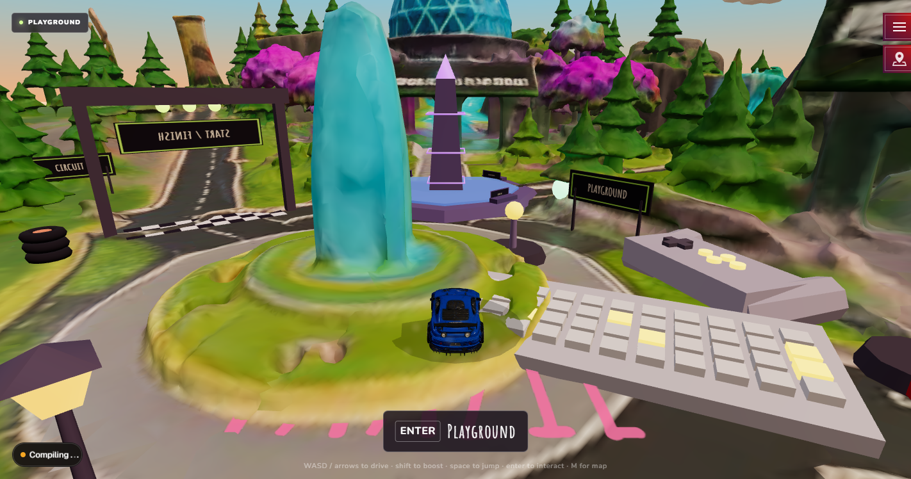
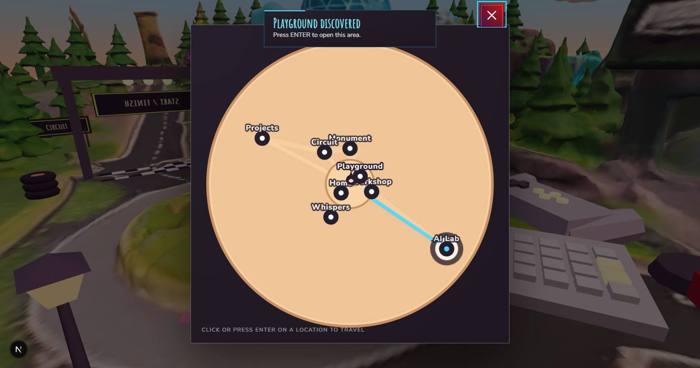

# Phase 5.1 — Actual laptop performance test

**Test date:** 2026-11-03  
**Target:** `http://127.0.0.1:3000/`  
**Requested browser:** visible Chrome  
**Result:** INCOMPLETE — visible-Chrome execution required

## Execution status

The requested visible-Chrome test could not be executed in this environment. The
computer-use service reported:

> The agent's own display is not available in the CLI on this system (it needs
> Linux with Xvfb). The OmniRush desktop app has one on macOS and Windows.

The person's screen was also unavailable because screen sharing is disabled.
Therefore this report contains no laptop hardware, FPS, CPU, RAM, heap, or load
timings. Existing headless/fallback measurements are not substituted for the
requested laptop results.

The local development server did respond successfully at the target URL with
HTTP 200. No browser session was available to inspect the page.

## A. Hardware

These non-personal system values were collected from the test laptop:

| Item | Recorded value |
| --- | --- |
| Processor | 12th Gen Intel(R) Core(TM) i3-1215U |
| Installed RAM | 15.69 GB |
| Windows | Windows 11 Home Single Language, version 10.0.26300 |
| Chrome | 156.0.8078.74 |
| Primary display | 1536 × 864 |
| Power mode | Balanced |
| Power state | On battery |
| Browser viewport | Not measured — visible Chrome unavailable |

## Prepared application checks

The normal development server was started with `npm run dev -- --hostname
127.0.0.1`. Direct HTTP checks returned the following results. These confirm
server and asset availability only; they do not confirm browser parsing,
terrain preprocessing, or game readiness.

| Check | Result |
| --- | --- |
| Application document | HTTP 200 |
| Optimized island GLB | HTTP 200; 42,001,232 bytes |
| Optimized Supra GLB | HTTP 200; 80,200,092 bytes |
| Browser loading overlay | Not measured |
| Terrain preprocessing | Not measured |
| Playable state | Not measured |

## B. GPU and measurement record

The following values are intentionally **not measured** in this run.

### GPU diagnostics

| Chrome GPU field | Actual laptop result |
| --- | --- |
| GPU vendor | Not measured — visible Chrome unavailable |
| GPU renderer | Not measured — visible Chrome unavailable |
| WebGL status | Not measured — visible Chrome unavailable |
| WebGL2 status | Not measured — visible Chrome unavailable |
| Graphics Feature Status | Not measured — visible Chrome unavailable |
| Hardware acceleration | Not measured — visible Chrome unavailable |
| SwiftShader in use | Not measured — visible Chrome unavailable |

## C. Loading measurements

| Run | Island load | Island terrain processing | Supra load/parse | Total game-ready |
| --- | ---: | ---: | ---: | ---: |
| Cold start 1 | Not measured | Not measured | Not measured | Not measured |
| Cold start 2 | Not measured | Not measured | Not measured | Not measured |
| Cold start 3 | Not measured | Not measured | Not measured | Not measured |
| Warm reload | Not measured | Not measured | Not measured | Not measured |

## D. Gameplay performance

| Metric | Actual laptop result |
| --- | --- |
| Idle FPS | Not measured |
| Driving FPS | Not measured |
| Boost FPS | Not measured |
| Jumping FPS | Not measured |
| Average frame time | Not measured |
| Worst frame time | Not measured |
| 1% low FPS | Not measured |
| CPU utilization | Not measured |
| RAM utilization | Not measured |
| JavaScript heap | Not measured |

## E. Resource usage

| Resource | Actual laptop result |
| --- | --- |
| CPU utilization | Not measured — visible Chrome/gameplay session unavailable |
| Total system RAM utilization | Not measured — visible Chrome/gameplay session unavailable |
| JavaScript heap | Not measured — browser session unavailable |

## Manual test procedure

Run these steps on the target laptop in visible Chrome. Keep the same Chrome
window size and power mode for every run. Record the values directly in the
tables above; do not use the prior headless values in this report.

### 1. Hardware verification

1. Open Chrome and navigate to `chrome://gpu`.
2. Capture the full page, or at minimum the sections **Graphics Feature
   Status**, **Problems Detected**, and **Driver Bug Workarounds**.
3. Record the GPU vendor and renderer from the **GPU0** row/details.
4. Record WebGL and WebGL2 status, the feature rows, and whether the page says
   hardware acceleration is enabled.
5. Mark SwiftShader as **yes** only when the renderer or feature details
   explicitly identify SwiftShader/software rendering. Otherwise record the
   displayed renderer verbatim.

### 2. Loading timings

1. Open DevTools (`F12`) before each run and select **Console** and
   **Performance**. In Network, enable **Disable cache** only for the three
   cold starts.
2. For each cold start, close the tab, open a new tab to
   `http://127.0.0.1:3000/`, and start a fresh recording/stopwatch at
   navigation. Wait until the loading overlay is gone and the intro prompt is
   visible.
3. In the Console, record the development logs named
   `[BrunoWorld] GLB island loaded` and `[BrunoWorld] Supra model loaded`.
   Copy their `loadMs` / `loadAndParseMs` values. The island log includes the
   terrain sampler diagnostics; record that processing information separately
   from the island asset time when the log exposes it.
4. Record total game-ready time from navigation start until the loading
   overlay disappears and the intro is ready. Use the same end condition for
   all four runs.
5. For the warm reload, use a normal reload after the first ready state with
   cache enabled. Record the same fields.

### 3. Five-minute performance sample

1. Start the experience, open DevTools **Performance**, and record a five-minute
   trace after the world is ready. Do not include the initial loading period.
2. Sample each state for a consistent interval and note the exact interval in
   the trace: idle, normal driving, boost, and jumping. Use the Performance
   FPS track or Chrome's frame timing data for FPS/frame-time values.
3. Record average frame time, worst frame time, and 1% low FPS from the trace.
   If Chrome does not expose a trustworthy 1% low value, write **unavailable**.
4. During the same run, open Windows Task Manager (`Ctrl+Shift+Esc`) and
   record the Chrome process CPU percentage and memory/RAM usage. Record the
   measurement method and timestamp because Task Manager values fluctuate.
5. In DevTools **Memory** or the Performance memory track, record
   `performance.memory.usedJSHeapSize` when available. If the API is not
   available, write **unavailable** rather than estimating heap usage.

## F. Functional regression checklist

Record **Pass**, **Fail**, or **Not tested**, plus a short observation and a
screenshot for each failure.

- [ ] Supra moves forward/backward and remains grounded on the island.
- [ ] Steering changes direction and braking stops/slows the car.
- [ ] Shift boost activates; Space jump lifts the car and it lands/grounds.
- [ ] Camera follows the car; drag orbit and wheel zoom remain responsive.
- [ ] Map opens with `M` and each map marker can be selected:
  - [ ] Mohamed's Home
  - [ ] Workshop
  - [ ] Playground
  - [ ] Monument
  - [ ] Circuit
  - [ ] Whisper Wall
  - [ ] Projects
  - [ ] AI Lab
- [ ] Map travel places the car at the selected location.
- [ ] Racing/Circuit can be started, driven, and stopped/restarted.
- [ ] Whisper Wall opens, accepts a message, and posts it locally.
- [ ] Console contains no errors during the full checklist.
- [ ] Network contains no failed requests. If a request is canceled by an
  intentional navigation, record it separately rather than treating it as a
  page failure.

Controls used by the checklist: WASD/arrows drive, Shift boosts, Ctrl-left or
B brakes, Space jumps, Enter interacts, M opens the map, T opens Whispers, and
left-click drag moves the camera.

## G. Evidence and screenshots

No new laptop screenshots could be captured because visible Chrome was
unavailable. The following repository screenshots are prior local verification
references only; they are not evidence of this laptop's GPU or performance:

For the manual run, add these captures beside this report or replace the
following checklist entries with the captured image paths:

- [ ] `chrome-gpu.png` — complete `chrome://gpu` evidence.
- [ ] `cold-start-1-ready.png`, `cold-start-2-ready.png`,
  `cold-start-3-ready.png` — ready-state/load evidence.
- [ ] `warm-reload-ready.png` — warm reload evidence.
- [ ] `performance-five-minute.png` — Performance trace summary.
- [ ] `functional-map-eight-locations.png` — map marker evidence.

## H. Limitations and prior fallback evidence

The existing Phase 5 artifacts were produced in `Chrome headless=new` without
verified hardware acceleration. They remain useful as implementation context,
but are excluded from the actual laptop result above. In particular, the
existing report states that visible Chrome/GPU verification was unavailable and
that its frame results were fallback measurements.

Additional unavailable values are the Chrome GPU page fields, browser viewport,
all four load-time runs, terrain sampler processing time, Supra parsing time,
all gameplay frame statistics, CPU/RAM sampling during play, JavaScript heap,
console errors, failed browser network requests, and functional regression
results. They must be recorded manually using the procedure above.

## I. Conclusion

**INCOMPLETE — manual testing still required.**

System identification and direct HTTP availability checks passed. The phase
cannot be marked hardware-verified until visible Chrome supplies `chrome://gpu`
results and the loading, gameplay, resource, console/network, and functional
measurements are recorded.
